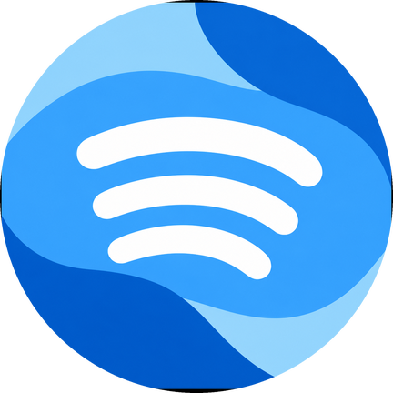

<div align="center">



<h1>Melophile</h1>

<p><b>Music, made material.</b></p>

<p>A modern, open-source YouTube Music client for Android and Desktop.<br />
Built with Kotlin Multiplatform, Compose, and Material 3 Expressive.</p>

<p>
  <a href="https://github.com/beyondbday69/Melophile/releases"></a>
  <a href="https://github.com/beyondbday69/Melophile/releases"></a>
  <a href="LICENSE"></a>
</p>

<p>
  
  
  
  
  
  
</p>

<p>
  <a href="#features"></a>
  <a href="#screenshots"></a>
  <a href="#download"></a>
  <a href="#privacy"></a>
  <a href="#build-from-source"></a>
</p>

</div>

> [!NOTE]
> **Independent fork, honest status.** Melophile is an independent, open-source client built on the foundations of SimpMusic. Playback relies on reverse-engineered YouTube Music and YouTube endpoints (similar to NewPipe, SmartTube, and InnerTune), so occasional breakage or transient stream throttling may occur until patches land. Melophile is free, ad-free, and non-commercial — no subscriptions, no ads, no fees. Please support artists directly and consider [YouTube Premium](https://www.youtube.com/premium) where available.

---

## Material 3, inside and out

Melophile is not Material 3 as a coat of paint. Color, shape, motion, and layout follow the same system on every screen — from the library to the player to settings.

<p align="center">
  
  
  
  
</p>

| Dynamic color | Expressive motion | Adaptive by default |
|:---:|:---:|:---:|
| Palettes pulled from your artwork, with tonal surfaces that keep content readable in light and dark themes. | Shape morphing, fluid transitions, and tactile controls that make the interface feel alive without getting in the way. | One Compose Multiplatform codebase tuned for phones, tablets, and desktop windows. |

## Features

<table>
<tr>
<td width="50%" valign="top">
<h3>🎧 Background &amp; ad-free</h3>
<p>Keep the music playing with the screen off — no ads, no interruptions, no subscriptions.</p>
</td>
<td width="50%" valign="top">
<h3>🎨 Material 3 Expressive player</h3>
<p>A Now Playing experience with expressive shapes, dynamic color, and fluid motion.</p>
</td>
</tr>
<tr>
<td width="50%" valign="top">
<h3>🎚️ 10-band equalizer</h3>
<p>Shape your sound with a draggable curve, presets, reverb and delay effects, plus AutoEq headphone profiles.</p>
</td>
<td width="50%" valign="top">
<h3>🎤 Synced lyrics</h3>
<p>Line-by-line and word-by-word lyrics via LRCLIB and community backends, with romanization support.</p>
</td>
</tr>
<tr>
<td width="50%" valign="top">
<h3>🔎 Explore everything</h3>
<p>Search the YouTube Music catalog and browse moods, genres, new releases, and charts.</p>
</td>
<td width="50%" valign="top">
<h3>📚 Your library</h3>
<p>Playlists, albums, artists, local playback, and offline caching — all in one place.</p>
</td>
</tr>
<tr>
<td width="50%" valign="top">
<h3>📊 Widgets &amp; stats</h3>
<p>Turntable player, quick playlists, and listening statistics on your home screen — computed on-device.</p>
</td>
<td width="50%" valign="top">
<h3>👥 Listen Together</h3>
<p>Host or join a shared listening room and keep everyone on the same track.</p>
</td>
</tr>
<tr>
<td width="50%" valign="top">
<h3>🌈 Material You theming</h3>
<p>Dynamic artwork palettes, dark and light themes, and customizable accent colors.</p>
</td>
<td width="50%" valign="top">
<h3>🚗 Anywhere playback</h3>
<p>Sleep timer, Android Auto, and native desktop builds for Linux, Windows, and macOS.</p>
</td>
</tr>
</table>

## Screenshots

<table>
<tr>
<td width="33%" align="center" valign="top">
  <a href="asset/screenshot/04.png"></a><br />
  <sub><b>Now Playing</b><br />Expressive shapes and dynamic color</sub>
</td>
<td width="33%" align="center" valign="top">
  <a href="asset/screenshot/05.png"></a><br />
  <sub><b>Discover</b><br />Search, moods, and new releases</sub>
</td>
<td width="33%" align="center" valign="top">
  <a href="asset/screenshot/06.png"></a><br />
  <sub><b>Library</b><br />Playlists, albums, and artists</sub>
</td>
</tr>
<tr>
<td width="33%" align="center" valign="top">
  <a href="asset/screenshot/10.png"></a><br />
  <sub><b>Stats</b><br />Your listening, on-device</sub>
</td>
<td width="33%" align="center" valign="top">
  <a href="asset/screenshot/12.png"></a><br />
  <sub><b>Playlists</b><br />Artwork-driven color and shape</sub>
</td>
<td width="33%" align="center" valign="top">
  <a href="asset/screenshot/15.png"></a><br />
  <sub><b>Listen Together</b><br />Shared rooms, in sync</sub>
</td>
</tr>
</table>

## Download

| Platform | Package | Get Melophile |
|:---|:---|:---|
| **Android 8.0+** | `.apk` | [Download the latest release](https://github.com/beyondbday69/Melophile/releases) |
| **Windows 10/11** | `.msix` / `.exe` | [Download the latest release](https://github.com/beyondbday69/Melophile/releases) |
| **macOS** | `.dmg` | [Download the latest release](https://github.com/beyondbday69/Melophile/releases) |
| **Linux** | `.AppImage` | [Download the latest release](https://github.com/beyondbday69/Melophile/releases) |

## Privacy

- **Zero tracking.** No tracking SDKs, no telemetry harvesting, and no third-party marketing trackers in standard builds.
- **Local-first listening.** Your library, playback history, and listening statistics live on your device.
- **Optional Google history.** Melophile only contacts Google recommendation endpoints if you explicitly log in and choose to sync your history back to your YouTube account.

## Build from source

**Prerequisites:** JDK 21, the Android SDK for Android builds, and Git.

```bash
git clone --recurse-submodules https://github.com/beyondbday69/Melophile.git
cd Melophile

# Android
./gradlew :androidApp:assembleDebug

# Desktop — stage libmpv, then run
./gradlew :composeApp:mpvSetupAll
./gradlew :desktopApp:run
```

> The `core` module is a git submodule. If you cloned without `--recurse-submodules`, run `git submodule update --init --recursive` first.

**Stack:** Kotlin Multiplatform · Compose Multiplatform · Material 3 · Media3 · Room · Ktor · Koin

## Community & support

<p align="center">
  <a href="https://discord.gg/Rq5tWVM9Hg"></a>
  <a href="https://github.com/beyondbday69/Melophile/issues"></a>
</p>

## Acknowledgements

- **[maxrave-dev](https://github.com/maxrave-dev)** (Tuan Minh Nguyen Duc) — original creator and architect of SimpMusic, which established the core architecture and foundations.
- **[InnerTune](https://github.com/z-huang/InnerTune)**, **[SmartTube](https://github.com/yuliskov/SmartTube)** & **[LRCLIB](https://lrclib.net/)** for open-source tools, extractor techniques, and lyric backends.

## Legal disclaimer

Melophile is an open-source, educational, personal media client. It does not store or host any audio or video files on independent servers; all media streaming is requested client-side directly from public YouTube/Google content distribution endpoints.

<div align="center">
<sub>Made with Kotlin, Compose, and a lot of Material 3.</sub>
</div>
